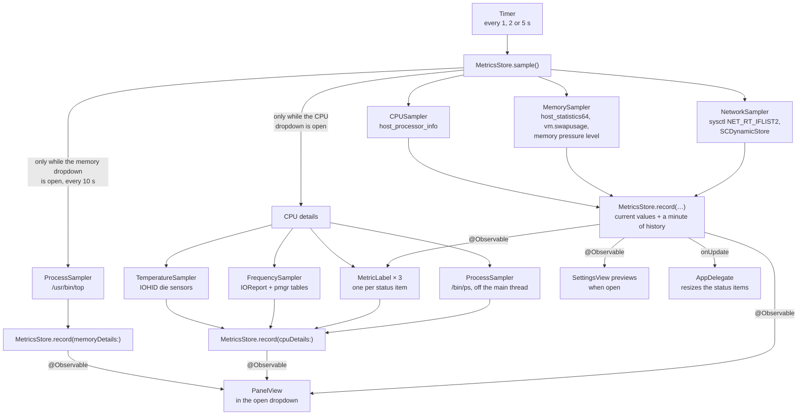

# How Menu Bar Monitor is built

What the pieces are and how they fit together. The map of files is in
[CONTRIBUTING.md](../CONTRIBUTING.md#the-layout-of-the-code); the reasoning behind a
particular choice is in the commit that made it, and the ones that are not obvious are
collected at the end of this page.

## One tick

Every reading is taken on the main thread. That sounds wrong for a monitor, but a round is
a few Mach calls and one walk of the process list, the whole app stays under 1% CPU at the
default interval, and it keeps the state free of locks. The timer is a one-shot rescheduled after each tick, so a
new interval in Settings applies from the next reading without restarting anything, and it
runs in the `.common` run loop mode so it keeps ticking while a menu is open.

## The pieces

**The samplers** (`Model/`) each keep the previous raw counters and return the difference
as a rate. That is why the first reading after launch has no CPU figure, no network rate
and no app list: there is nothing yet to subtract. `MetricsStore` adds no history point
for a missing CPU reading, so the graph does not start with a false zero.

**`MetricsStore`** (`State/`) holds the latest reading of each metric, 60 readings of
history, today's traffic, and — while the CPU dropdown is open — the CPU details. It is
told which dropdown is open (`detailMetric`), takes the details straight away when the CPU
one opens, and again half a second later so the clock speed, a difference between two
readings, does not wait a whole interval. `sample()` asks the samplers; `record(…)` applies a round of
readings, and is the seam the tests and the screenshot generator use to feed known values.

**The status items** — one per `Metric`, each owned by a `StatusItemController` in
`AppDelegate`. Each item's button hosts an `NSHostingView` with that metric's
`MetricLabel`. The hosting view refuses hit-testing, so clicks reach the button, and it
reports size changes so the item can be resized to fit. Switching a metric off in Settings
hides its item (`isVisible`), observed through `withObservationTracking`.

**The dropdowns** — each item has its own `DropdownPanel`, a borderless non-activating
`NSPanel` at pop-up menu level, holding a `PanelView` for that metric, made the first time
it is opened. It sits in an `NSVisualEffectView` with the popover material and a rounded
mask. `DropdownState` keeps
at most one open: a click on another item moves the dropdown there, a second click on the
same item closes it, and a click anywhere outside the app or Escape closes it.

**Settings** is a plain `NSWindow` with an `NSHostingController`. The app has no Dock icon
or menu bar of its own (`LSUIElement`), so SwiftUI's `Settings` scene has nowhere to hang.

## Decisions that are not the obvious ones

**An `NSStatusItem`, not SwiftUI's `MenuBarExtra`.** A `MenuBarExtra` label is rendered as
one image and one string; shapes, stacks and colours in it are dropped. Live coloured
graphs need a real view in the menu bar, and only a status item's button can hold one.

**Three status items, not one.** The first version drew all three metrics in one item
with one dropdown. Separate items are what the system's own items do: each gets its own
click target and highlight, can be ⌘-dragged on its own, is its own element to VoiceOver,
and disappears on its own when switched off. They are created right to left
(`Metric.creationOrder`) because macOS puts each new item to the left of the last, and
each has an autosave name so a position the user chose survives a relaunch.

**A custom panel, not an `NSPopover`.** A popover always draws an arrow and sits apart
from the menu bar. The panel drops straight down like a menu, which is what the item looks
like it should do.

**The popover material, not Liquid Glass.** The dropdowns started out on macOS 26's
regular glass (`NSGlassEffectView`). It lets so much of what is behind it through that over
a bright window it stayed light grey in dark mode, while the text stayed white, and the
dropdown could not be read. The popover material darkens in dark mode whatever is behind
it, as every system popover does, so the dropdowns use that on every version of macOS.

**Shapes, not `Canvas`.** The first version drew sparklines with SwiftUI's `Canvas`. It
looked identical and cost 94 MB, of which 69 MB was GPU memory owned by the process:
`Canvas` brings up Metal rendering, even for a 32-point graph. The same drawing as a
`Shape` takes the app to 18 MB. Measure with `footprint` before reaching for `Canvas`
again.

**Text sized to its widest value.** Each number in the menu bar sits in a frame the width
of `100%` or `↑ 99.9 MB/s`, drawn hidden underneath it. Without that, the whole item — and
every item to its left — would shuffle sideways each time a digit changed width. `Format`
switches unit before any rate outgrows that frame, and a test sweeps rates from bytes to
terabytes to keep it so.

**64-bit network counters from `sysctl`, not `getifaddrs`.** `getifaddrs` exposes each
interface's byte counts in `if_data`, whose fields are 32-bit and wrap every 4 GB — on a
fast connection, every few seconds. `NET_RT_IFLIST2` returns `if_data64`.

**The primary interface only.** With a VPN up, the same traffic passes through the tunnel
and then through Wi-Fi; summing every interface would count it twice. The app reads the
interface macOS routes through from the System Configuration store and measures that one.

**App CPU per core.** Activity Monitor and Stats count 100% as one core kept busy, so a
busy app passes 100% while the total stays low; the dropdown does the same, so the figures
can be compared with them directly. One decimal is kept below 10%.

**Memory per app from `top`, every ten seconds.** Activity Monitor's Memory column is a
process's physical footprint. `ps` has no such column — its resident size counts shared
memory in every process that maps it, and ranks the list differently — and an ordinary
process can read the footprint of its own user's processes only. `/usr/bin/top` is setuid
root and reports it for all of them, but one run costs about 0.6 s of CPU on a Mac with
seven hundred processes. So it runs when the memory dropdown opens and then every ten
seconds (`Throttle`), off the main thread; footprints move slowly enough for that.
Processes outside any app are named from their executable's path, because `top` cuts
names to sixteen characters.

**System processes from `ps`.** An ordinary process may read the CPU time of its own
user's processes only, which leaves out `WindowServer`, `kernel_task` and every daemon.
`/bin/ps` is installed setuid root to read them all, so the CPU dropdown runs it — off the
main thread, with fixed arguments, only while that dropdown is open — and parses its three
columns. Its percentages are the kernel's own short decaying average, as Stats shows.

**Temperature and clock speed from undocumented interfaces.** Apple silicon has no public
interface for either. The CPU die sensors answer through IOHID's event-system client, and
each core reports how long it spent at each clock step through IOReport; the power
manager's registry entry holds the frequency of each step, in Hz on some chips and kHz on
others. Neither needs root, which is why they are used rather than `powermetrics`. Both
are looked up with `dlsym`, so when a macOS update removes one, that figure shows "—" and
nothing else changes. A cluster's table is the one with as many entries as its cores have
steps, and clusters are matched to the kinds of core from `sysctl` by speed, slowest first;
when the counts do not line up, only the all-cores figure is shown.

**Helpers counted under their app.** Safari's web pages, Chrome's renderers and Xcode's
build tools are separate processes. Each one is attributed to the process macOS holds
responsible for it, then to that app's bundle, so the list reads as apps. The lookup uses
a private function found with `dlsym`; when it is missing, the app bundle in the process's
own path is used instead.

**Offscreen screenshots.** The machine this was built on has no screen-recording
permission, so `--snapshot` renders views offscreen: `ImageRenderer` for pure SwiftUI, an
offscreen window for anything with AppKit controls in it. The dropdowns are rendered on a
plain background, because the material behind them blurs what is on screen, and offscreen
there is nothing. That is also why the glass problem above was not caught before it
shipped: no offscreen capture can show what a material does over a bright window.
