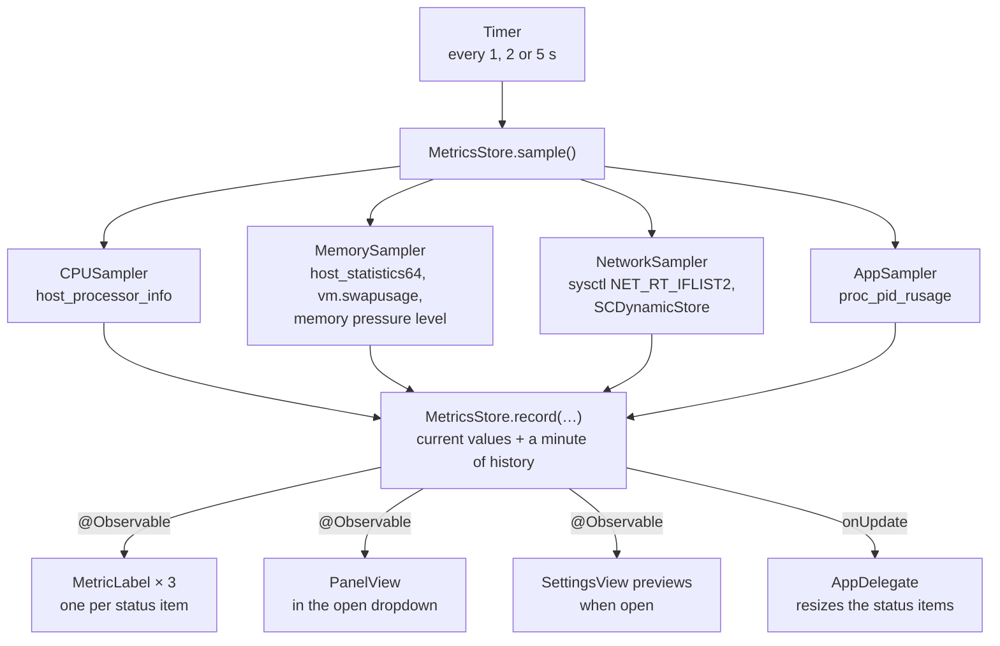

# How Menu Bar Monitor is built

What the pieces are and how they fit together. The map of files is in
[CONTRIBUTING.md](../CONTRIBUTING.md#the-layout-of-the-code); the reasoning behind a
particular choice is in the commit that made it, and the ones that are not obvious are
collected at the end of this page.

## One tick

Every reading is taken on the main thread. That sounds wrong for a monitor, but a round is
a few Mach calls and one walk of the process list, the whole app stays under 1% CPU at the
default interval, and it keeps the state free of locks. The timer is a one-shot rescheduled after each tick, so a
new interval in Settings applies from the next reading without restarting anything, and it
runs in the `.common` run loop mode so it keeps ticking while a menu is open.

## The pieces

**The samplers** (`Model/`) each keep the previous raw counters and return the difference
as a rate. That is why the first reading after launch has no CPU figure, no network rate
and no app list: there is nothing yet to subtract. `MetricsStore` adds no history point
for a missing CPU reading, so the graph does not start with a false zero.

**`MetricsStore`** (`State/`) holds the latest reading of each metric, 60 readings of
history, and today's traffic. `sample()` asks the samplers; `record(…)` applies a round of
readings, and is the seam the tests and the screenshot generator use to feed known values.

**The status items** — one per `Metric`, each owned by a `StatusItemController` in
`AppDelegate`. Each item's button hosts an `NSHostingView` with that metric's
`MetricLabel`. The hosting view refuses hit-testing, so clicks reach the button, and it
reports size changes so the item can be resized to fit. Switching a metric off in Settings
hides its item (`isVisible`), observed through `withObservationTracking`.

**The dropdowns** — each item has its own `DropdownPanel`, a borderless non-activating
`NSPanel` at pop-up menu level, holding a `PanelView` for that metric, made the first time
it is opened. On macOS 26 and later it sits in an `NSGlassEffectView`; before that, in an
`NSVisualEffectView` with the popover material and a rounded mask. `DropdownState` keeps
at most one open: a click on another item moves the dropdown there, a second click on the
same item closes it, and a click anywhere outside the app or Escape closes it.

**Settings** is a plain `NSWindow` with an `NSHostingController`. The app has no Dock icon
or menu bar of its own (`LSUIElement`), so SwiftUI's `Settings` scene has nowhere to hang.

## Decisions that are not the obvious ones

**An `NSStatusItem`, not SwiftUI's `MenuBarExtra`.** A `MenuBarExtra` label is rendered as
one image and one string; shapes, stacks and colours in it are dropped. Live coloured
graphs need a real view in the menu bar, and only a status item's button can hold one.

**Three status items, not one.** The first version drew all three metrics in one item
with one dropdown. Separate items are what the system's own items do: each gets its own
click target and highlight, can be ⌘-dragged on its own, is its own element to VoiceOver,
and disappears on its own when switched off. They are created right to left
(`Metric.creationOrder`) because macOS puts each new item to the left of the last, and
each has an autosave name so a position the user chose survives a relaunch.

**A custom panel, not an `NSPopover`.** A popover always draws an arrow and sits apart
from the menu bar. The panel drops straight down like a menu, which is what the item looks
like it should do.

**Shapes, not `Canvas`.** The first version drew sparklines with SwiftUI's `Canvas`. It
looked identical and cost 94 MB, of which 69 MB was GPU memory owned by the process:
`Canvas` brings up Metal rendering, even for a 32-point graph. The same drawing as a
`Shape` takes the app to 18 MB. Measure with `footprint` before reaching for `Canvas`
again.

**Text sized to its widest value.** Each number in the menu bar sits in a frame the width
of `100%` or `↑ 99.9 MB/s`, drawn hidden underneath it. Without that, the whole item — and
every item to its left — would shuffle sideways each time a digit changed width. `Format`
switches unit before any rate outgrows that frame, and a test sweeps rates from bytes to
terabytes to keep it so.

**64-bit network counters from `sysctl`, not `getifaddrs`.** `getifaddrs` exposes each
interface's byte counts in `if_data`, whose fields are 32-bit and wrap every 4 GB — on a
fast connection, every few seconds. `NET_RT_IFLIST2` returns `if_data64`.

**The primary interface only.** With a VPN up, the same traffic passes through the tunnel
and then through Wi-Fi; summing every interface would count it twice. The app reads the
interface macOS routes through from the System Configuration store and measures that one.

**App CPU as a share of the machine.** Activity Monitor reports per-core percentages, which
pass 100% for a busy app. Beside a CPU total of 23%, an app at 150% looks like a bug, so
the dropdown divides by the core count and the rows add up to the total. One decimal is
kept below 10%, since on a many-core Mac that is where most apps are.

**Helpers counted under their app.** Safari's web pages, Chrome's renderers and Xcode's
build tools are separate processes. Each one is attributed to the process macOS holds
responsible for it, then to that app's bundle, so the list reads as apps. The lookup uses
a private function found with `dlsym`; when it is missing, the app bundle in the process's
own path is used instead.

**Offscreen screenshots.** The machine this was built on has no screen-recording
permission, so `--snapshot` renders views offscreen: `ImageRenderer` for pure SwiftUI, an
offscreen window for anything with AppKit controls in it. The dropdown is rendered on a
plain background rather than in its glass panel, because a capture of the glass draws
large semibold text almost black in dark mode — the glass has nothing behind it to adapt
to.
