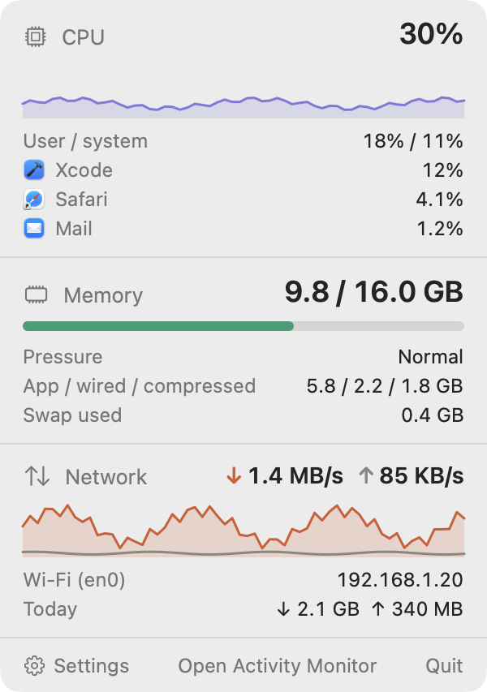

# Menu Bar Monitor

**CPU, memory and network at a glance, in your Mac's menu bar.**
Three small live graphs by default — or level bars, or plain numbers — and a dropdown with
the busiest apps, memory pressure and today's traffic. Native Swift, no dependencies, no
permissions to grant, and it never goes online.

[](https://github.com/rwijnen/menu-bar-monitor/actions/workflows/ci.yml)
[](LICENSE)
[](INSTALL.md#requirements)
[](INSTALL.md#requirements)
[](Package.swift)
[](#how-this-was-built)

> **Written by an AI.** Menu Bar Monitor was vibecoded — see
> [How this was built](#how-this-was-built) for who did what, and what that means for the
> code you are about to run.

```bash
git clone https://github.com/rwijnen/menu-bar-monitor.git
cd menu-bar-monitor && ./build.sh --install
```

About ten seconds, with Xcode or just the Command Line Tools. Full detail in
[INSTALL.md](INSTALL.md).

---

## In the menu bar

Three styles, switched in Settings. Sparklines are the default.

| | |
|---|---|
| **Sparklines**<br>the last 20 readings of each | <picture><source media="(prefers-color-scheme: dark)" srcset="Docs/menubar-sparklines-dark.png"></picture> |
| **Mini bars**<br>the narrowest | <picture><source media="(prefers-color-scheme: dark)" srcset="Docs/menubar-miniBars-dark.png"></picture> |
| **Icons and numbers**<br>exact values | <picture><source media="(prefers-color-scheme: dark)" srcset="Docs/menubar-iconsAndNumbers-dark.png"></picture> |

Upload and download are always shown as numbers, and every number sits in a space sized
for its widest value, so the item never shuffles sideways as digits change. With
**Colour warnings** on, CPU turns red above 85% and memory turns amber or red when macOS
reports memory pressure.

## The dropdown

Click the item for the detail.

<picture>
  <source media="(prefers-color-scheme: dark)" srcset="Docs/dropdown-dark.png">
  
</picture>

- **CPU** — the total, split into user and system time, a minute of history, and the
  three busiest apps. Helper processes count under the app responsible for them, so
  Safari's web pages count as Safari and a build counts as Xcode.
- **Memory** — what Activity Monitor calls *Memory Used*: app, wired and compressed
  memory, out of what is installed. Then macOS's own pressure level, and swap.
- **Network** — download and upload on the interface macOS is routing through, its name
  and address, and today's totals, which survive a restart and start again at midnight.
- **Settings**, **Open Activity Monitor** and **Quit** along the bottom. A click anywhere
  else closes it.

On macOS 26 and later it sits on the system's glass material.

## Settings

<picture>
  <source media="(prefers-color-scheme: dark)" srcset="Docs/settings-dark.png">
  
</picture>

The style picker previews each option with live data. Any metric can be hidden, as long as
one stays. The update interval is 1, 2 or 5 seconds, and **Launch at login** uses the
system's own login items.

## Where the numbers come from

| Metric | Source |
|---|---|
| CPU | `host_processor_info` tick counts across all cores, compared between readings |
| Memory used | `host_statistics64`: app + wired + compressed, as Activity Monitor counts it |
| Memory pressure | `kern.memorystatus_vm_pressure_level` |
| Swap | `vm.swapusage` |
| Network | 64-bit byte counters from `sysctl NET_RT_IFLIST2`, on the primary interface only |
| Busiest apps | `proc_pid_rusage` per process, grouped under the responsible app |

The readings were checked against `top`, `vm_stat` and `sysctl` on the machine it was
built on. Two choices differ from Activity Monitor on purpose: an app's CPU is its share of
the *whole* machine, so the list adds up to the total above it, and only the primary
interface is measured, so traffic through a VPN is not counted twice. The reasoning is in
[Docs/ARCHITECTURE.md](Docs/ARCHITECTURE.md).

## Light by design

A monitor that is heavy mostly measures itself. Menu Bar Monitor uses about **18 MB of
memory and under 1% CPU** at the default two-second interval, measured with `footprint`
and `top` against the running app.

That figure is what is left after one measurement changed the code. The first version drew
its graphs with SwiftUI's `Canvas` and used 94 MB — 69 MB of it GPU memory, because
`Canvas` brings up Metal even for a graph 32 points wide. The graphs are plain shapes now.

## Why it is safe to run

Three rules, which [CONTRIBUTING.md](CONTRIBUTING.md#what-it-is-and-is-not) holds every
change to:

- **It never goes online.** There is no networking code. The network graph reads the
  byte counters the kernel already keeps; it does not send anything.
- **It needs no privileges.** No root helper, no kernel extension, no entitlements, no
  permission prompts. That is also why system daemons do not appear among the busiest
  apps: they belong to other users, and an ordinary process cannot read them.
- **It writes only its own preferences** — your settings and today's traffic totals.

More in [SECURITY.md](SECURITY.md), including what is accepted rather than solved.

## Try it

```bash
swift test                                              # the whole suite, under a second
./build.sh                                              # build/MenuBarMonitor.app
.build/release/MenuBarMonitor --sample                  # live readings, to compare with top
.build/release/MenuBarMonitor --snapshot ~/Desktop/mbm  # every view as PNG, from demo data
```

## How this was built

Menu Bar Monitor was **vibecoded**. Essentially all of its code, tests, icon and
documentation were written by Claude (Opus 5.5) in
[Claude Code](https://claude.com/claude-code), from prompts by
[@rwijnen](https://github.com/rwijnen), who set out what the app should do, picked the
design from an interactive mockup, made the product decisions — sparklines as the default,
the three styles, the licence — and checked the result in a real menu bar. Every commit
carries a `Co-Authored-By: Claude` trailer, so `git log` shows exactly which parts that
covers: all of them.

This is stated plainly because you should know what you are reading before you trust it.
It does not lower the bar the code has to clear:

- The tests are real tests: formatting and graph geometry pinned exactly, the store fed
  known readings, and the samplers run against the live machine's counters. CI runs them
  on every push, then launches the built app to take real readings.
- Several things were corrected only after a test or a measurement contradicted the first
  attempt: the `Canvas` graphs that cost 75 MB, a network rate that a width test caught
  outgrowing its space in the menu bar above 100 GB/s, and today's traffic printed with the
  locale's decimal comma beside numbers with a point.
- The screenshots are rendered from the app's own views, not mock-ups.

What it does not mean: that anyone else has audited this. Machine-written code is still
code, with the ordinary risk of being confidently wrong in a way its author did not think
to test. It is small, commented, and MIT-licensed precisely so you can read it before
running it — and [issues](https://github.com/rwijnen/menu-bar-monitor/issues) about
anything it gets wrong are welcome.

## Licence and credits

[MIT](LICENSE) © 2026 Robin Wijnen.

The screenshots above are rendered offscreen from the app's own view code, with demo data
rather than a real machine's, because the machine it was built on has no screen-recording
permission. They show the dropdown on a plain background rather than its glass, and the
menu bar item without the rest of the menu bar.
