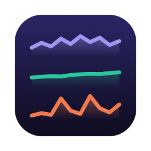
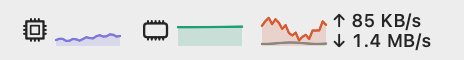
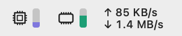
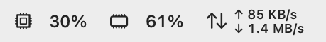
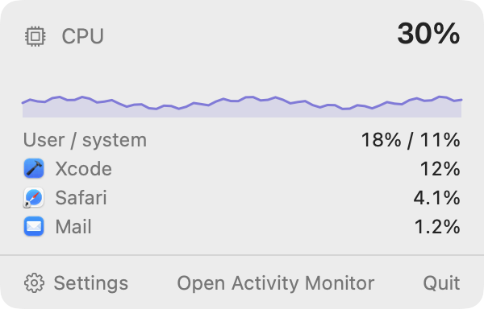
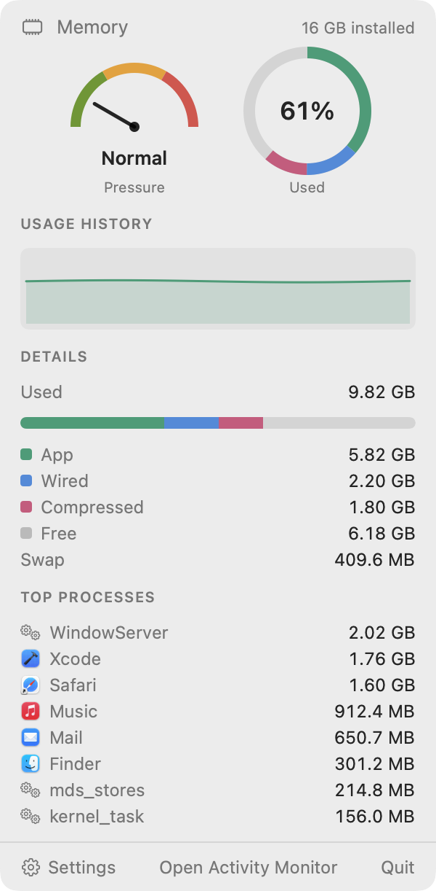
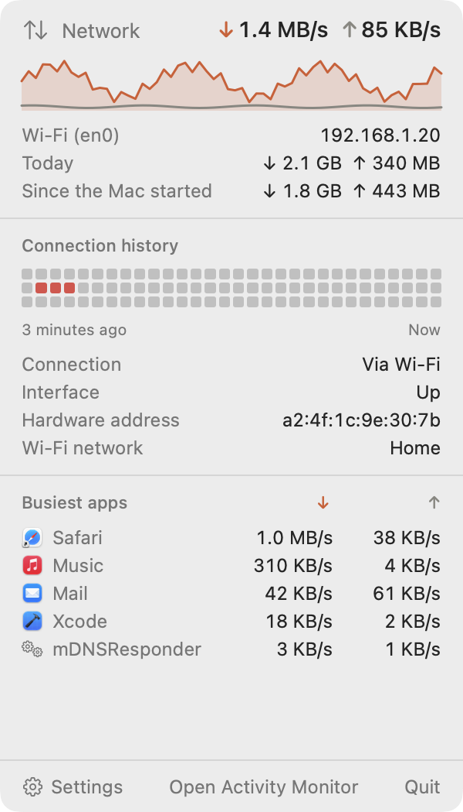
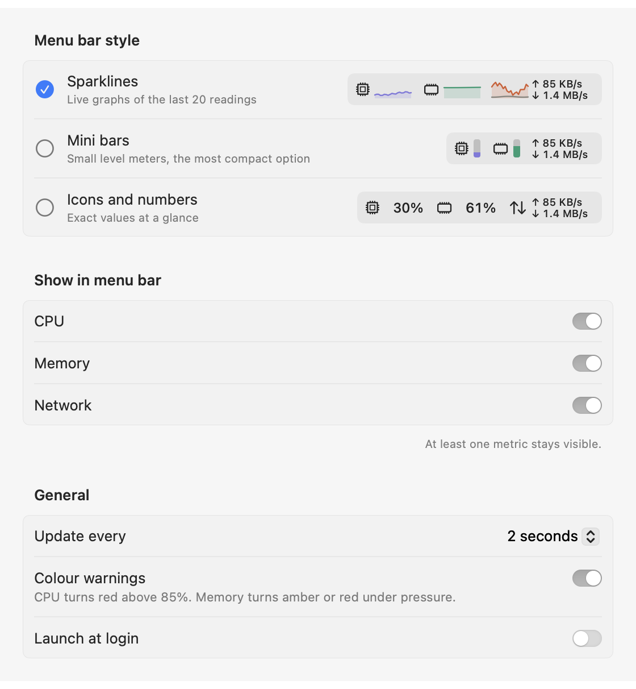

# Menu Bar Monitor

**CPU, memory and network at a glance, in your Mac's menu bar.**
Three small live graphs by default — or level bars, or plain numbers — each with its own
dropdown: the busiest apps, memory pressure, today's traffic. Native Swift, no dependencies, no
permissions to grant, and it never goes online.

[](https://github.com/rwijnen/menu-bar-monitor/actions/workflows/ci.yml)
[](LICENSE)
[](INSTALL.md#requirements)
[](INSTALL.md#requirements)
[](Package.swift)
[](#how-this-was-built)

> **Written by an AI.** Menu Bar Monitor was vibecoded — see
> [How this was built](#how-this-was-built) for who did what, and what that means for the
> code you are about to run.

```bash
git clone https://github.com/rwijnen/menu-bar-monitor.git
cd menu-bar-monitor && ./build.sh --install
```

About ten seconds, with Xcode or just the Command Line Tools. Full detail in
[INSTALL.md](INSTALL.md).

---

## In the menu bar

Three styles, switched in Settings. Sparklines are the default.

| | |
|---|---|
| **Sparklines**<br>the last 20 readings of each | <picture><source media="(prefers-color-scheme: dark)" srcset="Docs/menubar-sparklines-dark.png"></picture> |
| **Mini bars**<br>the narrowest | <picture><source media="(prefers-color-scheme: dark)" srcset="Docs/menubar-miniBars-dark.png"></picture> |
| **Icons and numbers**<br>exact values | <picture><source media="(prefers-color-scheme: dark)" srcset="Docs/menubar-iconsAndNumbers-dark.png"></picture> |

Upload and download are always shown as numbers, and every number sits in a space sized
for its widest value, so the item never shuffles sideways as digits change. With
**Colour warnings** on, CPU turns red above 85% and memory turns amber or red when macOS
reports memory pressure.

## The dropdowns

Each metric is its own item in the menu bar, with its own dropdown: click the CPU graph for
CPU, the network rates for network. Clicking another item moves the dropdown there, and a
click anywhere else closes it. Hold ⌘ and drag any of them to put them in another order.

| CPU | Memory | Network |
|---|---|---|
| <picture><source media="(prefers-color-scheme: dark)" srcset="Docs/dropdown-cpu-dark.png"></picture> | <picture><source media="(prefers-color-scheme: dark)" srcset="Docs/dropdown-memory-dark.png"></picture> | <picture><source media="(prefers-color-scheme: dark)" srcset="Docs/dropdown-network-dark.png"></picture> |

- **CPU** — temperature, usage and clock speed as three gauges; a minute of history and
  a bar for each core, coloured by kind (Performance and Super cores on an M5 Pro);
  system, user and idle time and each kind of core's usage; uptime; the load average
  over 1, 5 and 15 minutes; the clock speed of each kind of core; and the eight busiest
  apps, system processes included. A helper process counts under the app responsible
  for it, so Safari's web pages count as Safari and a build counts as Xcode. App figures
  are per core, as in Activity Monitor: 100% is one core kept busy.
- **Memory** — macOS's pressure level as a dial, and what Activity Monitor calls
  *Memory Used* as a ring split into app, wired and compressed memory; a minute of
  history; the same breakdown as a bar, with free memory and swap; and the eight apps
  using the most, system processes included, by the physical footprint Activity
  Monitor's Memory column shows.
- **Network** — download and upload on the interface macOS is routing through, its name
  and address, and today's totals, which survive a restart and start again at midnight.

Each ends with **Settings**, **Open Activity Monitor** and **Quit**. On macOS 26 and later
the dropdowns sit on the system's glass material.

## Settings

<picture>
  <source media="(prefers-color-scheme: dark)" srcset="Docs/settings-dark.png">
  
</picture>

The style picker previews each option with live data. Any metric's item can be hidden, as
long as one stays. The update interval is 1, 2 or 5 seconds, and **Launch at login** uses the
system's own login items.

## Where the numbers come from

| Metric | Source |
|---|---|
| CPU, per core | `host_processor_info` tick counts, compared between readings |
| Kinds of core | `sysctl hw.perflevel…` |
| CPU temperature | Apple silicon's die sensors (`PMU tdie…`) through IOHID — undocumented |
| Clock speed | Time at each clock step from IOReport, weighted by the power manager's frequency tables — undocumented |
| Load average, uptime | `getloadavg`, `kern.boottime` |
| Memory used | `host_statistics64`: app + wired + compressed, as Activity Monitor counts it |
| Memory pressure | `kern.memorystatus_vm_pressure_level` |
| Swap | `vm.swapusage` |
| Network | 64-bit byte counters from `sysctl NET_RT_IFLIST2`, on the primary interface only |
| Busiest apps by CPU | `/bin/ps`, which can see every user's processes, grouped under the responsible app |
| Busiest apps by memory | `/usr/bin/top`'s physical footprint, likewise for every user, grouped the same way |

The readings were checked against `top`, `vm_stat`, `sysctl` and `uptime` on the machine
it was built on, and the temperature against Stats. Temperature and clock speed have no public interface on Apple
silicon; the sources used need no root, but Apple does not document them, so a future
macOS may stop answering and the gauge then shows "—". Only the primary network interface
is measured, so traffic through a VPN is not counted twice. The reasoning is in
[Docs/ARCHITECTURE.md](Docs/ARCHITECTURE.md).

## Light by design

A monitor that is heavy mostly measures itself. Menu Bar Monitor uses about **18 MB of
memory and under 1% CPU** at the default two-second interval, measured with `footprint`
and `top` against the running app.

That figure is what is left after one measurement changed the code. The first version drew
its graphs with SwiftUI's `Canvas` and used 94 MB — 69 MB of it GPU memory, because
`Canvas` brings up Metal even for a graph 32 points wide. The graphs are plain shapes now.

The CPU and memory dropdowns' extras are read only while that dropdown is open. The CPU
process list means running `ps` once a reading, about 20 ms of CPU each time. The memory
list comes from `top`, which costs about 0.6 s of CPU a run, so it runs when the memory
dropdown opens and then every ten seconds while it stays open. With the dropdowns closed
neither ever runs.

## Why it is safe to run

Three rules, which [CONTRIBUTING.md](CONTRIBUTING.md#what-it-is-and-is-not) holds every
change to:

- **It never goes online.** There is no networking code. The network graph reads the
  byte counters the kernel already keeps; it does not send anything.
- **It needs no privileges of its own.** No root helper, no kernel extension, no
  entitlements, no permission prompts. To list other users' processes it runs `/bin/ps`
  and `/usr/bin/top`, which macOS ships with that right, with fixed arguments and only
  while the CPU or memory dropdown is open.
- **It writes only its own preferences** — your settings and today's traffic totals.

More in [SECURITY.md](SECURITY.md), including what is accepted rather than solved.

## Try it

```bash
swift test                                              # the whole suite, under a second
./build.sh                                              # build/MenuBarMonitor.app
.build/release/MenuBarMonitor --sample                  # live readings, to compare with top
.build/release/MenuBarMonitor --snapshot ~/Desktop/mbm  # every view as PNG, from demo data
```

## How this was built

Menu Bar Monitor was **vibecoded**. Essentially all of its code, tests, icon and
documentation were written by Claude (Opus 5.5) in
[Claude Code](https://claude.com/claude-code), from prompts by
[@rwijnen](https://github.com/rwijnen), who set out what the app should do, picked the
design from an interactive mockup, made the product decisions — sparklines as the default,
the three styles, the licence — and checked the result in a real menu bar. Every commit
carries a `Co-Authored-By: Claude` trailer, so `git log` shows exactly which parts that
covers: all of them.

This is stated plainly because you should know what you are reading before you trust it.
It does not lower the bar the code has to clear:

- The tests are real tests: formatting and graph geometry pinned exactly, the store fed
  known readings, and the samplers run against the live machine's counters. CI runs them
  on every push, then launches the built app to take real readings.
- Several things were corrected only after a test or a measurement contradicted the first
  attempt: the `Canvas` graphs that cost 75 MB, a network rate that a width test caught
  outgrowing its space in the menu bar above 100 GB/s, and today's traffic printed with the
  locale's decimal comma beside numbers with a point.
- The screenshots are rendered from the app's own views, not mock-ups.

What it does not mean: that anyone else has audited this. Machine-written code is still
code, with the ordinary risk of being confidently wrong in a way its author did not think
to test. It is small, commented, and MIT-licensed precisely so you can read it before
running it — and [issues](https://github.com/rwijnen/menu-bar-monitor/issues) about
anything it gets wrong are welcome.

## Licence and credits

[MIT](LICENSE) © 2026 Robin Wijnen.

The screenshots above are rendered offscreen from the app's own view code, with demo data
rather than a real machine's, because the machine it was built on has no screen-recording
permission. They show the dropdown on a plain background rather than its glass, and the
menu bar item without the rest of the menu bar.
